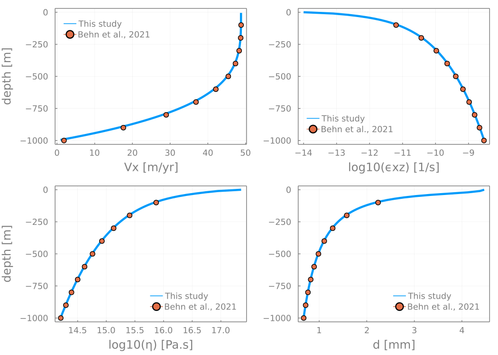
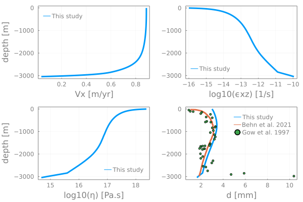
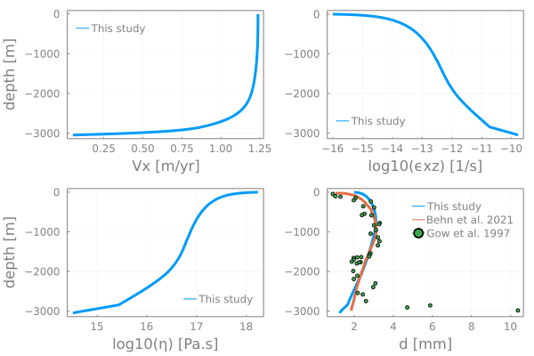
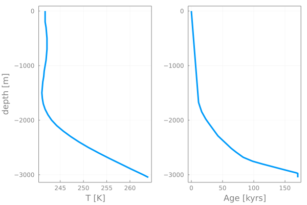
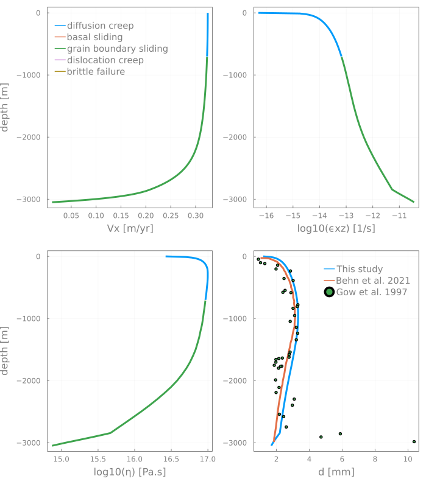
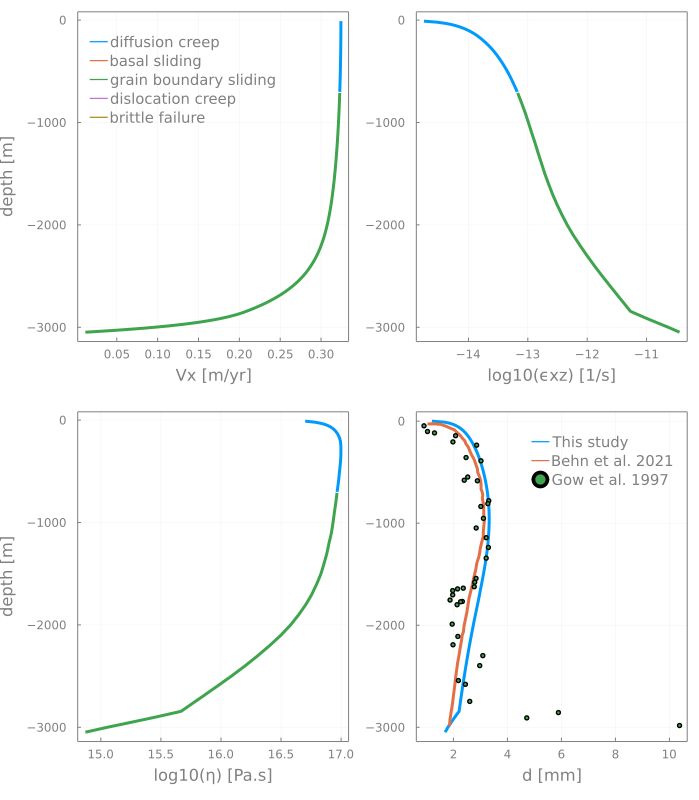
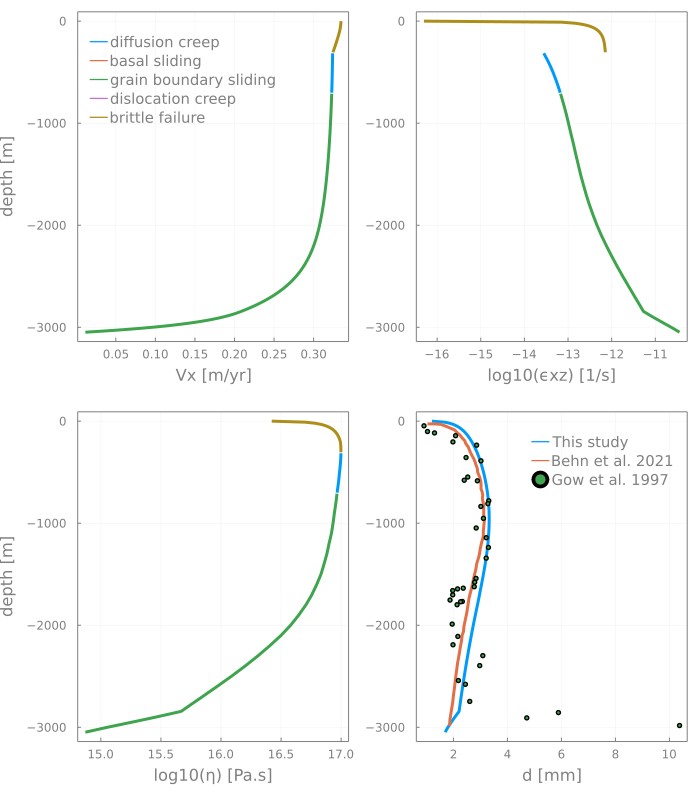

# Ice grain size evolution
Grain size evolution model for composite ice rheology.

This repository contains [Julia] routines implementing Goldsby composite ice rheology to assess discrepancies versus the widely used Glen's flow law. A consistent implementation of the composite rheological Goldsby model requires to resolve grain size evolution.

We implement the wattmeter ([Austin and Evans, 2007](https://doi.org/10.1130/G23244A.1)) to predict grain size evolution as a function of grain growth and grain reduction parameters for 1D and future 2D and 3D ice flow applications. In our model we reformulate the experimentally parameterized flow law relation using an effective viscosity approach as a function of the second stress or strain-rate invariants.

# Content
* [Benchmark](#benchmark)
* [Complex rheology](#complex-rheology)
* [References](#references)

# Benchmark
We benchmark our wattmeter-based grain-size evolution implementation against results submitted for publication to EGU's _The Cryopshere_ by [Behn et al. (2001)](https://doi.org/10.5194/tc-2020-295).

## Codes

### GSE implementation
The [**benchmark**](benchmark) folder contains 1D codes resolving the 1D ice column configuration (see [Section 3.3](https://doi.org/10.5194/tc-2020-295)):
- [`ice_column1D_lin.jl`](benchmark/ice_column1D_lin.jl) a linear viscous version
- [`ice_column1D_powlawEii.jl`](benchmark/ice_column1D_powlawEii.jl) a power-law Glen version with strain-rate dependent viscosity η(ε̇II)
- [`ice_column1D_powlawEii_Tii.jl`](benchmark/ice_column1D_powlawEii_Tii.jl) a power-law Glen version with stress dependent viscosity η(τII)
- [`ice_column1D_fixGS_Eii.jl`](benchmark/ice_column1D_fixGS_Eii.jl) a composite rheology (GBS and dislocation creep) version with strain-rate dependent viscosity η(ε̇II) and fixed grain size
- [`ice_column1D_fixGS_Tii.jl`](benchmark/ice_column1D_fixGS_Tii.jl) a composite rheology (GBS and dislocation creep) version with stress dependent viscosity η(τII) and fixed grain size
- [`ice_column1D_GSE_Tii.jl`](benchmark/ice_column1D_GSE_Tii.jl) a composite rheology (GBS and dislocation creep) version with stress dependent viscosity η(τII) and grain size evolution

The symbolic math derivation of "experimental to model" formulation is done in the [`FlowLawConversionFromLab2.ipynb`](benchmark/FlowLawConversionFromLab2.ipynb) notebook.

### GSE application
The [**gisp2**](gisp2) folder contains the codes to reproduce the ice core data configuration (see [Section 3.4](https://doi.org/10.5194/tc-2020-295)):
- [`ice_column1D_fixGS_Tii_GISP2.jl`](benchmark/ice_column1D_fixGS_Tii_GISP2.jl) a composite rheology (GBS and dislocation creep) version with stress dependent viscosity η(τII), fixed grain size and temperature data for the GISP2 setup.
- [`ice_column1D_GSE_Tii_GISP2_Temp.jl`](gisp2/ice_column1D_GSE_Tii_GISP2_Temp.jl) a composite rheology (GBS and dislocation creep) version with stress dependent viscosity η(τII), grain size evolution and temperature data for the GISP2 setup.
- [`ice_column1D_GSE_Tii_GISP2.jl`](gisp2/ice_column1D_GSE_Tii_GISP2.jl) a composite rheology (GBS and dislocation creep) version with stress dependent viscosity η(τII), grain size evolution, temperature and depth-dependent age data for the for the GISP2 setup. Spatial (depth) age variability is implemented using a variable `dt` vector further used to converge a single time step with data-obtained age data.

## Results

### GSE implementation
We implemented the parameters and configuration from the 1D ice column case ([Section 3.3]((https://doi.org/10.5194/tc-2020-295))) to reproduce the Figure 6 using the [`ice_column1D_GSE_Tii.jl`](benchmark/ice_column1D_GSE_Tii.jl) code:

### GSE application
We implemented the parameters and configuration from the 1D ice core data case ([Section 3.4]((https://doi.org/10.5194/tc-2020-295))) to reproduce the Figure 7 using the [`ice_column1D_GSE_Tii_GISP2.jl`](gisp2/ice_column1D_GSE_Tii_GISP2.jl) code:

<!--  -->

The initial temperature, age and grain size distribution profiles are taken from [Clow et al. (1999)](https://doi.org/10.1594/PANGAEA.55517), [Ram et al. (2000)](https://doi.org/10.1029/2000JD900321) and [Gow et al. 1997](https://doi.org/10.1029/97JC00165), respectively:

# Complex rheology
We extend the [`ice_column1D_GSE_Tii_GISP2.jl`](gisp2/ice_column1D_GSE_Tii_GISP2.jl) code to include, besides grain boundary sliding (gbs) and dislocation creep mechanisms also diffusion and dislocation creep, elasticity and brittle failure. The [`ice_column1D_GSE_Tii_GISP2_allvep.jl`](gisp2/ice_column1D_GSE_Tii_GISP2_allvep.jl) is thus a more complete version allowing to test which are the active mechanisms in a given configuration. We here apply it to the [GISP2](gisp2) data for the

i) viscous case:

ii) visco-elastic case:

iii) visco-elasto-plastic case:

## 🚧 Work in progress

- Figure out the exact fitting parameters (`kgg` and others) used by Behn et al. to reproduce their **GSE application**
- Temperature-dependant rheology has a region T>259 K close to the base which seems not to be captured by Behn's results
- Add shear-heating for better fit ...

# References
[Austin, N. J., Evans, B. (2007). Paleowattmeters: A scaling relation for dynamically recrystallized grain size. Geology 35 (4): 343–346, https://doi.org/10.1130/G23244A.1.](https://doi.org/10.1130/G23244A.1)

[Behn, M. D., Goldsby, D. L., and Hirth, G. (2020). The role of grain-size evolution on the rheology of ice: Implications for reconciling laboratory creep data and the Glen flow law, The Cryosphere Discuss. \[preprint\], https://doi.org/10.5194/tc-2020-295, in review.](https://doi.org/10.5194/tc-2020-295)

[Clow, G.D. (1999). GISP2-D Temperature. PANGAEA, https://doi.org/10.1594/PANGAEA.55517](https://doi.org/10.1594/PANGAEA.55517)

[Gow, A. J., Meese, D. A., Alley, R. B., Fitzpatrick, J. J., Anandakrishnan, S., Woods, G. A., and Elder, B. C. (1997), Physical and structural properties of the Greenland Ice Sheet Project 2 ice core: A review, J. Geophys. Res., 102( C12), 26559– 26575, doi:10.1029/97JC00165.](https://doi.org/10.1029/97JC00165)

[Ram, M., Donarummo, J., Stolz, M. R. and Koenig, G. (2000). Calibration of laser-light scattering measurements of dust concentration for Wisconsinan GISP2 ice using instrumental neutron activation analysis of aluminum: Results and discussion, J. Geophys. Res., 105(D20), 24731–24738, doi:10.1029/2000JD900321.](https://doi.org/10.1029/2000JD900321)

[Julia]: https://julialang.org
